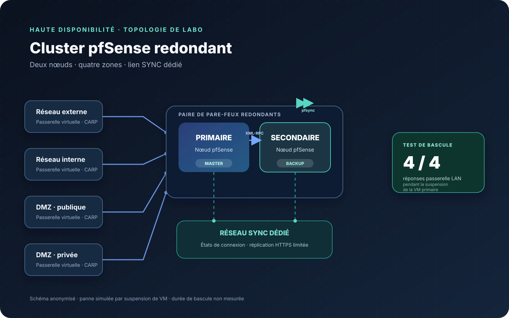

  <h1>Cluster pfSense en haute disponibilité</h1>
  
<strong>Conception, configuration et validation d'une paire de pare-feux redondants</strong>

  
pfSense 2.9.0 · VMware Workstation · bascule d'adresses · synchronisation d'état et de configuration

> Laboratoire d'infrastructure : lorsqu'un pare-feu primaire devient indisponible, le pare-feu secondaire peut-il maintenir la passerelle du réseau joignable ?

## Résultat

J'ai configuré un cluster de deux pare-feux pfSense et validé le cycle complet de bascule et de reprise dans un laboratoire virtualisé. Pendant la suspension contrôlée de la machine virtuelle primaire, le secondaire a repris les quatre adresses virtuelles. Un test de connectivité vers la passerelle interne a reçu **4 réponses sur 4**. À la reprise du primaire, celui-ci est redevenu `MASTER` et le secondaire `BACKUP`, sans état de double maître observé.

Il s'agit d'un résultat de laboratoire, pas d'une garantie de zéro interruption : la durée de bascule et le maintien de sessions déjà ouvertes n'ont pas été mesurés.

## Architecture

Chaque pare-feu possède des interfaces réseau virtuelles distinctes pour le réseau externe, le réseau interne et deux zones [DMZ (Demilitarized Zone, zone démilitarisée)](#dmz), ainsi qu'un réseau dédié à la synchronisation. Les deux nœuds utilisent le même ordre et les mêmes noms d'interfaces.

## Mécanismes configurés

| Mécanisme | Rôle dans le laboratoire |
|---|---|
| [CARP (Common Address Redundancy Protocol)](#carp) | Partage les adresses de passerelle virtuelles et élit le nœud actif. |
| [pfsync (synchronisation d'état du pare-feu)](#pfsync) | Synchronise l'état des connexions entre les pare-feux. |
| [XML-RPC (Extensible Markup Language Remote Procedure Call)](#xml-rpc) via [HTTPS (Hypertext Transfer Protocol Secure)](#https) | Réplique la configuration du primaire vers le secondaire au moyen d'une connexion web chiffrée. |
| Règles d'interface | Autorisent uniquement les flux de diagnostic, de réplication et de synchronisation nécessaires sur le lien dédié. |

## Résultats vérifiés

| Contrôle | Résultat observé |
|---|---|
| Fonctionnement normal | Primaire `MASTER` et secondaire `BACKUP` pour les quatre adresses virtuelles. |
| Réplication de configuration | Les quatre adresses virtuelles et les trois règles de l'interface de synchronisation étaient présentes sur le secondaire. |
| Synchronisation d'état | Chaque nœud affichait les identifiants des deux membres du cluster. |
| Simulation de panne du primaire | Après suspension de la VM primaire, le secondaire est devenu `MASTER` pour les quatre adresses virtuelles. |
| Joignabilité de la passerelle interne ([LAN (Local Area Network, réseau local)](#lan)) | Quatre réponses sur quatre pendant la suspension du primaire. |
| Reprise | Le primaire est redevenu `MASTER`, le secondaire `BACKUP`, sans double maître observé. |

Voir [VALIDATION.md](VALIDATION.md) pour le périmètre des tests et [TROUBLESHOOTING.md](TROUBLESHOOTING.md) pour le diagnostic des incidents.

## Apprentissages

- Une interface sans règle d'autorisation bloque par défaut le trafic entrant. Un ping en échec ne prouve pas à lui seul une panne de commutation ou de câblage.
- XML-RPC reprend le protocole et le port de l'interface web. Le passage de l'administration en HTTPS a aligné la réplication sur la règle du pare-feu et évité l'envoi du mot de passe administrateur en HTTP non chiffré.
- Les noms et l'ordre des interfaces doivent correspondre entre les deux nœuds lorsque la configuration est répliquée.
- Un test de bascule utile vérifie le changement de rôle et la joignabilité d'une passerelle pendant la panne simulée.

## Périmètre et limites

- La panne a été simulée par suspension de la machine virtuelle (VM) primaire, sans arrêt du système invité ni coupure d'alimentation physique.
- La durée de bascule n'a pas été mesurée.
- Le maintien de sessions applicatives ouvertes n'a pas été testé.
- La réplication d'une modification de configuration réalisée après l'installation n'a pas été testée.
- La connectivité a été vérifiée depuis le poste hôte vers la passerelle interne ; les services externes et les charges des zones démilitarisées ne faisaient pas partie des tests.

## Environnement du laboratoire

- pfSense Community Edition 2.9.0 sur deux machines virtuelles.
- VMware Workstation Pro 25H2.
- Cinq cartes réseau virtuelles par pare-feu, raccordées à des réseaux virtuels distincts.
- Un réseau dédié à la synchronisation d'état et à la réplication de configuration.

## Glossaire

- **HA — High Availability (haute disponibilité)** : maintien d'un service lorsqu'un composant tombe en panne.
- **IP — Internet Protocol (protocole Internet)** : protocole réseau utilisé ici pour adresser les passerelles virtuelles.
- **ARP — Address Resolution Protocol (protocole de résolution d'adresses)** : associe une adresse IP à une adresse matérielle sur le réseau local.
- **CARP — Common Address Redundancy Protocol** : protocole utilisé pour partager des adresses IP virtuelles et élire le nœud actif.
- **MASTER / BACKUP** : états du CARP ; le nœud MASTER porte les adresses virtuelles, le nœud BACKUP attend de les reprendre en cas de panne.
- **pfsync — synchronisation d'état du pare-feu** : mécanisme d'échange des informations de connexion entre les pare-feux.
- **XML-RPC — Extensible Markup Language Remote Procedure Call** : mécanisme pfSense de transfert de configuration du primaire vers le secondaire.
- **HTTPS — Hypertext Transfer Protocol Secure** : transport web chiffré utilisé pour la réplication de configuration.
- **HTTP — Hypertext Transfer Protocol** : protocole web non chiffré.
- **TCP — Transmission Control Protocol** : protocole de transport fiable utilisé ici pour HTTPS.
- **DMZ — Demilitarized Zone (zone démilitarisée)** : zone réseau séparée, destinée aux services dont l'exposition est contrôlée.
- **LAN — Local Area Network (réseau local)** : réseau interne desservi par la passerelle virtuelle.
- **WAN — Wide Area Network (réseau étendu)** : côté externe du laboratoire, raccordé au réseau de [NAT (Network Address Translation, traduction d'adresses réseau)](#nat) de VMware.
- **SYNC** : réseau dédié à la synchronisation d'état et à la réplication de configuration entre les deux nœuds.
- **NAT — Network Address Translation (traduction d'adresses réseau)** : mécanisme VMware utilisé ici pour l'accès du réseau externe du laboratoire.
- **VM — Virtual Machine (machine virtuelle)** : ordinateur logiciel qui héberge ici un pare-feu.
- **ICMP — Internet Control Message Protocol** : protocole de contrôle utilisé par le test de connectivité `ping`.

## Confidentialité

Ce résumé public ne contient volontairement ni adresses IP du laboratoire, ni noms de machines ou de domaine, ni identifiants matériels, ni captures brutes, ni sauvegardes de configuration, ni support de cours. Les libellés de la topologie sont génériques.

